<p align="center"></p>

Haniny is a driving-safety assistant built by our team in a 48-hour hackathon, with Lloyd Assurances as the insurance partner. A phone mounted in the car stands in for an OBD-II box: it streams speed, acceleration and two camera feeds to a FastAPI backend. One feed watches the driver, the other watches the road, and every detection feeds a trip score in a Flutter app that can also raise an SOS after a crash.

## What it detects

| Driver camera | Road camera | Trip |
|---|---|---|
| Drowsiness and eye closure (MediaPipe face mesh) | Stop signs (Haar cascade) | Live risk score per trip |
| Distraction and phone use | Animals on the road (YOLOv8n) | Daily and weekly stats |
| Smoking, posture | Road damage (YOLOv8n, stock weights) | Accident detection and SOS |

## How it works

<p align="center"></p>

<sub>Diagram source: [docs/diagrams/readme-diagram.mmd](docs/diagrams/readme-diagram.mmd)</sub>


## Run it

Backend (Python 3.11):

```bash
cd backend
python -m venv .venv && source .venv/bin/activate
pip install -r requirements.txt
export HANINY_JWT_SECRET="$(openssl rand -hex 32)"
uvicorn main:app --host 0.0.0.0 --port 8000
```

The admin routes (`/admin/users`, `/admin/alerts`) are off unless you set `HANINY_ADMIN_TOKEN` and send it as `X-Admin-Token`.

App: set `baseUrl` in `mobile_app/lib/services/api_service.dart` to your backend's address, then `flutter pub get && flutter run`. [`hardware-sim/`](hardware-sim/README.md) describes the phone that plays the car.

## Status

A hackathon prototype. Detection accuracy and end-to-end latency were never measured, and road-damage detection runs on stock YOLOv8n weights, so treat it as a placeholder. The app talks to the backend over plain HTTP on the local network and keeps its token in SharedPreferences; the device-pairing lookup is unauthenticated and returns the paired driver's name and car model. Fine for a demo, not for real drivers.

`design/` holds the UI frames and `assets/logos/` the brand, colours included.

## License

MIT, see [LICENSE](LICENSE).
